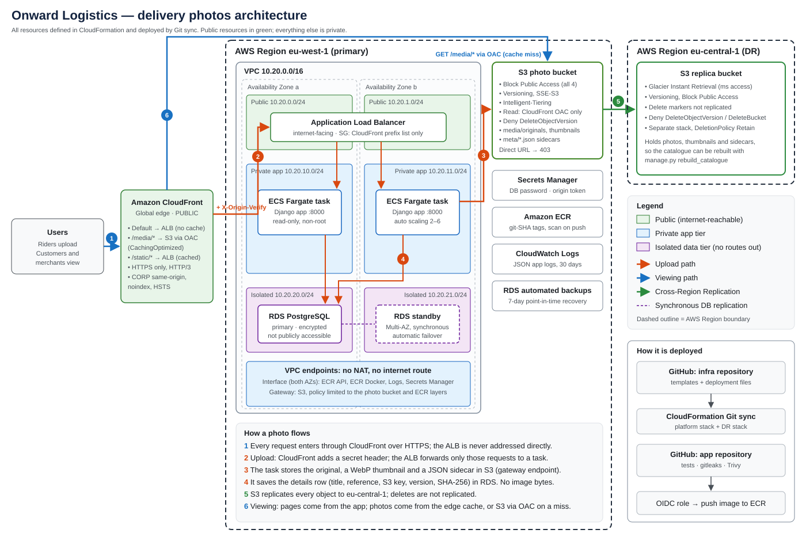

# AWS-Onward-Delivery-Photos-Storage-Infra

The AWS infrastructure for Onward Logistics' proof-of-delivery photos, deployed from this
repository by **CloudFormation Git sync**. The application lives in its own repository,
[AWS-Onward-Delivery-Photos-Storage-App](https://github.com/RUYANGA/AWS-Onward-Delivery-Photos-Storage-App). Its GitHub Actions
push each image to ECR, and **AWS CodePipeline** releases it to ECS with a **CodeDeploy blue/green** deployment.



Decisions: [docs/decisions.md](docs/decisions.md). Recovery procedures: [docs/runbook.md](docs/runbook.md).

## What this creates

| Stack | Region | Template | What it holds |
| --- | --- | --- | --- |
| `onward-dev-bootstrap` | eu-central-1 and eu-west-1 | `bootstrap/bootstrap.yaml` | GitHub connection, Git sync role and sync configs; in eu-west-1 also ECR, the deploy-bundle bucket, the nested-template bucket and the GitHub Actions roles |
| `onward-dev-photos-dr` | eu-central-1 | `templates/photos-dr.yaml` | Replica bucket that receives every photo |
| `onward-dev-platform` | eu-west-1 | `templates/platform.yaml` + 5 nested stacks | Everything that serves the photos |
| `onward-dev-pipeline` | eu-west-1 | `templates/pipeline.yaml` | CodeDeploy app + deployment group, CodePipeline, EventBridge rule |

- **Photos:** private S3 bucket with versioning, Block Public Access and Cross-Region Replication to a Glacier Instant Retrieval replica. Bucket policies deny permanent version deletes and bucket deletion.
- **Details:** Multi-AZ RDS for PostgreSQL 16 in isolated subnets. RDS generates and rotates the password in Secrets Manager.
- **Configuration:** the app's `.env` values live in SSM Parameter Store under `/onward/dev/app/` (one parameter per variable); ECS injects them, and the database credentials, when a task starts.
- **App:** ECS Fargate (2 to 6 tasks across 2 AZs) in private subnets with no internet route. AWS APIs are reached through VPC endpoints.
- **Entry point:** CloudFront is the only public URL. `/media/*` is served from S3 through Origin Access Control. The internet-facing ALB accepts only CloudFront's prefix list, and AWS WAF blocks any request without CloudFront's secret origin header.

## Repository layout

```
bootstrap/bootstrap.yaml        turns Git sync on (connection, Git sync role, sync configs), ECR, deploy-bundle bucket, GitHub Actions roles
templates/photos-dr.yaml        recovery Region: replica bucket
templates/pipeline.yaml         release pipeline: ECR push -> EventBridge -> CodePipeline -> CodeDeploy blue/green
templates/platform.yaml         primary Region ROOT stack: parameters, wiring, outputs
templates/network.yaml            nested: VPC, subnets, routes, security groups, VPC endpoints,
                                    ALB + blue/green target groups + WAF origin lock
templates/database.yaml           nested: Multi-AZ RDS for PostgreSQL
templates/edge.yaml               nested: CloudFront, OAC, response header policies
templates/storage.yaml            nested: photo bucket, replication, bucket policy
templates/application.yaml        nested: ECS Fargate, IAM roles, Parameter Store config,
                                    auto scaling, release alarms
templates/gitsync-placeholder.yaml  empty stack Git sync can update (created by bootstrap.sh)
deployments/dev/*.yaml          Git sync deployment files: parameters and tags per stack
scripts/bootstrap.sh            build or rebuild from scratch
scripts/deploy-direct.sh        deploy the stacks with the CLI while Git sync waits for connection approval
scripts/teardown.sh             delete after a demo (cost control)
scripts/check_standards.sh      no inline policies, IAM users, keys or SSH; deployment files valid (also in CI)
scripts/nested-templates.sh     version / check / publish the nested templates
scripts/live-review-checks.sh   one command per client check
docs/                           architecture diagram, decision log, runbook
.github/workflows/validate.yml  cfn-lint, company standards, nested template publish, gitleaks
```

## Releasing an app change

```
app repo, merge to main
  GitHub Actions   test -> build -> Trivy scan -> push :<git-sha>
                   -> upload deploy/deploy-bundle.zip (taskdef.json + appspec.yaml) -> push :latest
  EventBridge      ECR push of :latest starts the pipeline
  CodePipeline     Source   the :latest image + the deploy bundle (S3)
                   Deploy   CodeDeploy blue/green
```

During **Deploy**, CodeDeploy starts the new version as a "green" task set behind the second
target group and checks it on the test listener (port 8080, not reachable from the internet).
It then moves the production listener to green (`DeploymentConfig`: all at once, or a 10%
canary for 5 minutes first) and keeps the old "blue" tasks running for `KeepOldVersionMinutes`.
If the 5xx alarm or either target group's unhealthy-host alarm fires, it rolls back automatically.

| You change | Released by | Trigger |
| --- | --- | --- |
| Code in AWS-Onward-Delivery-Photos-Storage-App | **CodePipeline + CodeDeploy** `onward-dev-photos-release` | the app's CI pushes `:latest` to ECR (every merge to `main`) |
| Templates or deployment files in this repository | **CloudFormation Git sync** | merge to `main` in this repository |

- **To release:** merge to `main` in the app repository. Watch it at the `PipelineConsoleUrl` output of `onward-dev-pipeline`.
- **Versions:** every release is the git SHA of the app commit: its ECR tag, shown on the app's About page and `/readyz`. ECR keeps the **last 10 releases** (lifecycle rule in `bootstrap/bootstrap.yaml`) and deletes older ones. Each pipeline run in *Executions* shows the image digest it deployed and the `Version` / `Reason` variables.
- **To roll back:** during the `KeepOldVersionMinutes` window, *Stop and roll back* the deployment in CodeDeploy (traffic returns to blue at once). After that, roll back to **any of the last 10 releases** with the app repository's *Actions > rollback* workflow (empty version lists them; a git SHA redeploys it). It starts this pipeline with that exact image digest, blue/green with the same alarms, and labels the run with the version and reason. Then revert the bad commit in the app repository.
- **Configuration changes:** `.env` values are SSM parameters created by `templates/application.yaml` (most come from `deployments/dev/platform.yaml`, e.g. `StudentFullName`, `MaxUploadMb`). Change the value and merge; Git sync updates the parameter, and the next release (or any replaced task) reads the new value. No task definition change is needed.
- **Task definition changes:** with `DeploymentController: CODE_DEPLOY`, CodeDeploy owns the running task definition, the listeners and which target group is live, and CloudFormation cannot update them on this service. Change CPU, memory or environment variables in `templates/application.yaml` (for new environments); for the live service the next release carries them, because each release's task definition is rendered from the latest registered revision. `ImageTag` in `deployments/dev/platform.yaml` is used only when the stack is first created.

## Platform stack: nested templates

`templates/platform.yaml` is a short root template. It holds the parameters, wires the five nested stacks together and publishes the outputs. Each nested template owns one domain, so every resource lives with the ones it belongs to:

| Nested stack | Template | Contains | Inputs from |
| --- | --- | --- | --- |
| `NetworkStack` | `templates/network.yaml` | VPC, 6 subnets, route tables, security groups, VPC endpoints; the ALB, blue/green target groups, listeners, and the WAF origin lock with its secret | none |
| `DatabaseStack` | `templates/database.yaml` | Multi-AZ RDS for PostgreSQL | network |
| `EdgeStack` | `templates/edge.yaml` | CloudFront, OAC, response header policies | network |
| `StorageStack` | `templates/storage.yaml` | Photo bucket, Cross-Region Replication role, bucket policy | edge |
| `ApplicationStack` | `templates/application.yaml` | ECS cluster, IAM roles, `.env` values in Parameter Store, task definition, service, auto scaling, release alarms | network, database, storage |

The photo bucket's name is computed once in the root stack and passed to the stacks that need it. That lets CloudFront be created before the bucket, so the storage stack can own the bucket policy, which must name the distribution.

CloudFormation reads nested templates from S3, and Git sync does not upload them. CI publishes the five nested templates to `s3://onward-dev-cfn-templates-<account>-eu-west-1/platform/<version>/`, where `<version>` is a 12-character content hash and each object can be written only once. The root template picks the version through `NestedTemplatesVersion` in `deployments/dev/platform.yaml`.

**To change a nested template:** edit it, run `./scripts/nested-templates.sh version`, put the result in `NestedTemplatesVersion` in `deployments/dev/platform.yaml`, and open a pull request. CI lints, checks the version and uploads the templates; on merge Git sync updates only the nested stacks that changed. To add a nested template, also list it in `NESTED_TEMPLATES` at the top of `scripts/nested-templates.sh`.

## Company standards

- **Naming:** `onward-<environment>-<component>`; bucket names add the account ID and Region; IAM names add the Region when both Regions create one.
- **Tags:** the deployment files set `Project`, `Environment`, `Owner`, `CostCenter`, `DataClassification` and `ManagedBy`; CloudFormation copies them to every taggable resource. Align values with the Client Profile.
- **No inline policies:** only AWS managed policies and `AWS::IAM::ManagedPolicy`. The Git sync role is explicitly denied `iam:PutRolePolicy`, `iam:CreateUser` and `iam:CreateAccessKey`. Checked in CI by `scripts/check_standards.sh`.
- **No long-lived keys:** GitHub Actions uses OIDC, Git sync uses CodeConnections. ECS reads app configuration from Parameter Store and database credentials from Secrets Manager; the task definition holds no values, only references.

## Build or rebuild from scratch

Prerequisites: AWS CLI v2 signed in through SSO or a role, and both repositories on GitHub under
the same owner. The Regions (`eu-west-1`, `eu-central-1`), environment (`dev`), GitHub owner and
repository are defaults in `scripts/lib.sh`; override one for a single run with e.g.
`ENVIRONMENT=staging`. Put the CloudFront origin-facing prefix list ID and `StudentFullName` in
`deployments/dev/platform.yaml`:

```bash
aws ec2 describe-managed-prefix-lists --region eu-west-1 \
  --filters Name=prefix-list-name,Values=com.amazonaws.global.cloudfront.origin-facing \
  --query 'PrefixLists[0].PrefixListId' --output text
```

1. `./scripts/bootstrap.sh connection`, then follow the steps it prints:
   authorise both GitHub connections in the console (AWS requires a person to approve access to
   GitHub; it is the only console step), give the AWS Connector GitHub app access to this
   repository, and set the GitHub Actions variables in both repositories and push both to `main`.
   Infra CI then publishes the nested templates, and app CI pushes the first image (it skips the
   deploy bundle because no task definition exists yet).
2. `./scripts/bootstrap.sh sync`. Git sync only updates stacks that already exist, so the script
   creates each stack from an empty placeholder first. It builds `onward-dev-photos-dr` (the
   replica must exist before replication), then `onward-dev-platform` from the `:latest` image
   (about 25 minutes: RDS Multi-AZ and CloudFront), and prints the public address.
3. Re-run the app's workflow (*Actions > release > Run workflow* on `main`). Now that the task
   definition exists, it uploads the first deploy bundle.
4. `./scripts/bootstrap.sh sync` again. It creates `onward-dev-pipeline` (it imports the platform's
   exports) and prints the pipeline link. From then on every merge to the app's `main` branch is
   released blue/green.

**Already have AVAILABLE GitHub connections** (for example from an earlier lab)? Reuse them and
skip the console. Connections are Regional, so pass one per Region:

```bash
aws codeconnections list-connections --region eu-west-1 --query 'Connections[].[ConnectionName,ConnectionStatus,ConnectionArn]'
PRIMARY_CONNECTION_ARN=<eu-west-1 arn> DR_CONNECTION_ARN=<eu-central-1 arn> ./scripts/bootstrap.sh sync
```

**Connections not approved yet?** `./scripts/deploy-direct.sh` deploys the same stacks with the
AWS CLI from the same `deployments/dev/*.yaml` files (replica, platform, then the pipeline once a
deploy bundle exists). After the connections are approved, `./scripts/bootstrap.sh sync` turns Git
sync on and it adopts those stacks unchanged.

From then on, every commit that changes a template or a file in `deployments/dev/` updates its stack automatically.

## Live review

```bash
./scripts/live-review-checks.sh urls             # public URL and bucket names
./scripts/live-review-checks.sh storage-private  # direct S3 403 vs CloudFront 200, CORP headers
./scripts/live-review-checks.sh alb-locked       # ALB refuses requests not from CloudFront
./scripts/live-review-checks.sh db-private       # RDS not public, private IP, connection times out
./scripts/live-review-checks.sh credentials      # task definition uses Secrets Manager valueFrom
./scripts/live-review-checks.sh s3-recover       # delete, restore from version, permanent delete denied
./scripts/live-review-checks.sh replica          # today's photo exists in eu-central-1
./scripts/live-review-checks.sh kill-task        # stop a task while the site keeps answering
./scripts/live-review-checks.sh az-spread        # tasks run in two AZs
./scripts/live-review-checks.sh db-failover      # Multi-AZ failover
```

Record deletion and restore are shown in the app (**Delete photo** → **Deleted photos** → **Restore photo**).
To show a release, change the app, merge to `main`, and watch CodeDeploy shift traffic from blue to green while the site keeps answering.

## Teardown

`./scripts/teardown.sh` stops Git sync and deletes the pipeline, platform and replica stacks
(set `DbDeletionProtection: "false"` and merge first; RDS takes a final snapshot). The photo
buckets, replica, ECR repository, template and deploy-bundle buckets are retained on purpose (evidence and
release history). To remove a bucket, an account administrator deletes its policy, empties all
versions and then deletes it. Rebuild with `./scripts/bootstrap.sh sync`.
